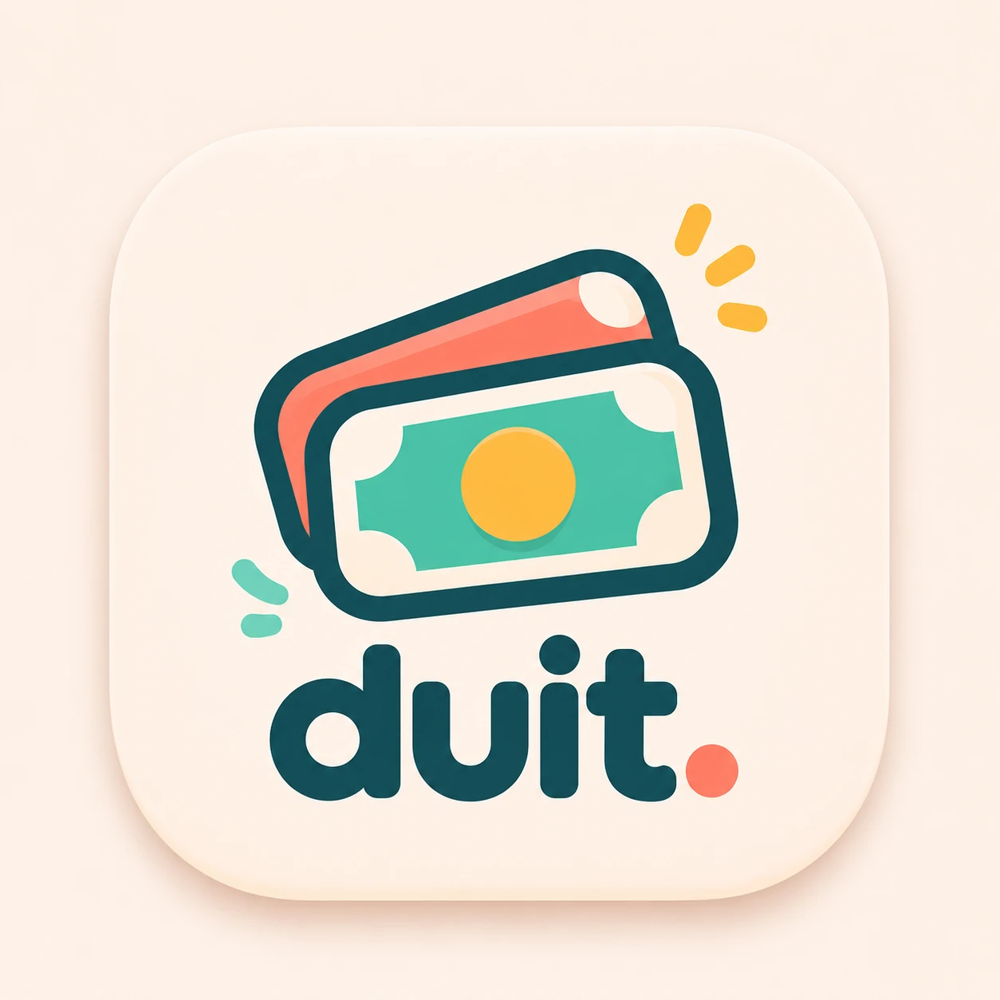

<p align="center">
  
</p>

<h1 align="center">duit.</h1>

<p align="center"><b>Your money, made simple. A local-first personal finance app for Android.</b></p>

<p align="center">
  
  
  
  
</p>

> **Public Beta Notice (`v1.2.0-beta.2` / `com.diniy.duit.beta`, `versionCode 1001902`)**  
> This is an open-source public beta release intended for testing and feedback. Official signed APK downloads and in-app updates are distributed via [`erlingdiniy/duit-beta`](https://github.com/erlingdiniy/duit-beta/releases); source code lives here in [`erlingdiniy/duit`](https://github.com/erlingdiniy/duit). Please create an encrypted backup (**Settings -> Backup & Restore**) before installing or upgrading from an earlier build.

`duit.` helps you track wallets, see what is safe to spend for the rest of your salary cycle, attach receipts locally, plan bills and savings goals, and understand your spending patterns—without creating an account or syncing your financial history to any cloud server.

---

## Features

- **Dual Visual Themes (Light & Dark):**
  - **Candy Bubble 2.0:** Tactile pastel surfaces with **Fredoka** display type and **Nunito** body/tabular numerals.
  - **Pure Liquid Glass:** Translucent frosted aesthetic with selectable **LOW / MID / HIGH** glass intensity, AGSL shader refraction on Android 13+ (API 33+), frosted blur fallback on Android 12 (API 31–32), and clean translucent surfaces on Android 10–11.
- **Wallets & Exact Integer Accounting:** Manage cash, bank, e-wallet, and savings accounts with income, expenses, transfers, and a Quick Action sheet. All monetary values are stored and calculated in integer *sen* (`Long`) to prevent floating-point rounding drift.
- **Safe to Spend:** Calculates what remains free to spend in the current pay cycle after reserving upcoming commitments and protected savings.
- **Planning Tools:**
  - **Savings Goals** with targets, progress tracking, and protected balances.
  - **Budgets** for monthly totals or specific categories, with 80% and 100% threshold alerts.
  - **Bills, PayLater & Debts** tracking in one commitment view.
  - **Savings Challenges**, **Smart Money Calendar** (with custom reminders), **My Tax Pocket**, and **Little Wins Club** milestones.
  - **Optional Commission Tracking:** Sales, gross profit, and payout tracking (disabled by default in public builds; toggleable in Settings).
- **Receipt Vault:** Attach local PDF, JPG, or PNG receipts to transactions. Files remain in private app storage and are included in encrypted `.duitbackup` archives.
- **Insights & Money Personality:** Income vs. spending trends, category breakdowns, and a shareable PNG summary card.
- **12 Glance Home Screen Widgets:** Safe to Spend, Wallets, Quick Add, Savings Goals, Upcoming Payments, Budgets, Pulse, Payday, Summary, Commitments, Buddy, and Privacy Mode toggle.
- **Security & Backups:**
  - 6-digit App Lock PIN (salted PBKDF2 key derivation backed by Android Keystore) plus optional biometric unlock (`USE_BIOMETRIC`).
  - Blocks screenshots and obscures recents previews while App Lock is active, with one-tap **Privacy Mode** amount masking across screens and widgets.
  - **AES-256-GCM** password-encrypted `.duitbackup` exports with staged atomic restore, alongside plain-text CSV exports.

---

## Screenshots

Personal screenshots from live devices are intentionally excluded from this source repository so no private financial data is ever committed. Screenshots using `duit.`'s built-in sample data (`SamplePreviewData`) can be added under `docs/screenshots/`.

---

## Requirements

- **OS:** Android 10 (API 29) or higher
- **Target SDK:** Android 15 (API 35)
- **Visual tiering:** Full AGSL Liquid Glass optics require Android 13+ (API 33+); Android 12 (API 31–32) uses RenderEffect frosted glass, and Android 10–11 uses a clean translucent fallback.

---

## Installation (Public Beta APK)

1. Open the [`erlingdiniy/duit-beta` Releases](https://github.com/erlingdiniy/duit-beta/releases) page for `v1.2.0-beta.2` on your Android device and download **`duit-1.2.0-beta.2.apk`** under **Assets**.
2. *(Recommended)* Verify the APK SHA-256 checksum against the hash published in the release notes before installing:
   ```bash
   sha256sum duit-1.2.0-beta.2.apk
   ```
   Or on Windows PowerShell:
   ```powershell
   Get-FileHash .\duit-1.2.0-beta.2.apk -Algorithm SHA256
   ```
3. Tap the APK to install. If prompted, allow your browser or file manager to install unknown apps.

**Upgrading & Downgrading Notes:**
- Upgrading over `com.diniy.duit.beta` `1.1.1` (`1001001`) or `1.2.0-beta.1` (`1001901`)—either manually or via the in-app updater—preserves existing local data (back up via **Settings -> Backup & Restore** first as a precaution).
- Android does not allow downgrading `1.2.0-beta.2` (`versionCode 1001902`) back to `1.1.1` or `1.2.0-beta.1` without uninstalling.

---

## Building from Source

### Prerequisites
- **JDK 17**
- **Android SDK 35** (`compileSdk = 35`, `minSdk = 29`)

### Personal / Offline Builds (`com.diniy.duit`)
Personal build types strip the `INTERNET` permission and exclude the Firebase SDK completely:

```powershell
# Debug build
.\gradlew.bat :app:assembleDebug

# Unsigned release build (R8 enabled)
.\gradlew.bat :app:assembleRelease
```

### Public Beta Build (`com.diniy.duit.beta`)
```powershell
.\gradlew.bat :app:assembleBeta
```

- **Maintainer-only configuration excluded from version control:** Signing keystores (`.p12` / `.jks`), passwords, and `app/src/beta/google-services.json` are excluded from version control. Source builds without those files compile and pass unit tests cleanly: FCM Developer Broadcasts skip initialization cleanly without `google-services.json`, and **Settings -> Support duit.** displays a friendly notice while donations are temporarily unavailable.
- Official beta signing reads four environment variables configured in [`app/build.gradle.kts`](app/build.gradle.kts): `DUIT_BETA_KEYSTORE`, `DUIT_BETA_STORE_PASSWORD`, `DUIT_BETA_KEY_ALIAS`, and `DUIT_BETA_KEY_PASSWORD`.

### Running Tests
```powershell
.\gradlew.bat :app:testDebugUnitTest :app:testBetaUnitTest
```

---

## Local-First Architecture & Privacy

- **Zero accounts, zero cloud sync:** All wallets, transactions, goals, budgets, commitments, and receipts live strictly in your phone's local Room SQLite database and DataStore preferences.
- **No Android auto-backup:** `android:allowBackup="false"` is enforced in [`app/src/main/AndroidManifest.xml`](app/src/main/AndroidManifest.xml) so Android does not automatically upload local records to Google Drive.
- **No ads or analytics:** No advertising SDKs or usage trackers are included. In `com.diniy.duit.beta`, Firebase Analytics and ADID collection are explicitly disabled in [`app/src/beta/AndroidManifest.xml`](app/src/beta/AndroidManifest.xml).
- **Network usage in public builds (`com.diniy.duit.beta` only):**
  1. **Update checks:** Queries GitHub Releases (`erlingdiniy/duit-beta`) and verifies both the downloaded APK SHA-256 digest and signing certificate before Android prompts you to install.
  2. **Help & Feedback (opt-in):** Sends only category, message, optional email, app version, and a random installation ID to the developer's Google Apps Script backend (`feedback-backend/Code.gs`)—never balances, transactions, or logs.
  3. **Developer Broadcasts (FCM):** Subscribes to public beta broadcast notifications (`duit_developer_broadcasts` notification channel) without transmitting personal financial records.

See [`docs/PRIVACY.md`](docs/PRIVACY.md) for the privacy policy document.

---

## Known Limitations (`v1.2.0-beta.2`)

- **Public beta status:** `1.2.0-beta.2` is a pre-release build intended for broader community testing; verify backups before major changes.
- **On-device database encryption scope:** The local Room database relies on Android's app-private storage sandbox rather than separate SQLCipher database encryption. Exported `.duitbackup` archives *are* encrypted with AES-256-GCM using your password (forgotten backup passwords cannot be recovered).
- **Receipt Vault hardware preview coverage:** Storage, migration, size/memory caps, backup/restore atomicity, and UI tests are covered by automated tests and code review, **but live on-device preview rendering of attached PDF/JPG receipts has not yet been tested on physical hardware** (the QA test device had 0 attached receipts).
- **Environment-gated Beta tests:** Four opt-in tests (`SavingsGoalFormRenderTest`, `LiveFeedbackSmokeTest`, `CandySwitchRenderTest`, and `CandyButtonRenderTest`) require explicit opt-in environment configuration and are skipped during standard local test runs.
- **Backup & receipt bounds:** Single receipt attachments (`10 MB` cap) and `.duitbackup` restore payloads (`12 MB` receipts / `32 MB` encrypted file cap) enforce documented size limits to prevent out-of-memory failures during backup/restore.

---

## Contributing & License

- Contributions and bug reports are welcome! Please read [`CONTRIBUTING.md`](CONTRIBUTING.md) before opening an issue or pull request, and **never post personal financial balances, transactions, backups, or PINs** on GitHub.
- **License:** Licensed under the **Apache License, Version 2.0** — see [`LICENSE`](LICENSE) for the full license text and [`NOTICE`](NOTICE) for required copyright and third-party notices (including SIL Open Font License 1.1 notices for the bundled **Fredoka** and **Nunito** fonts).
